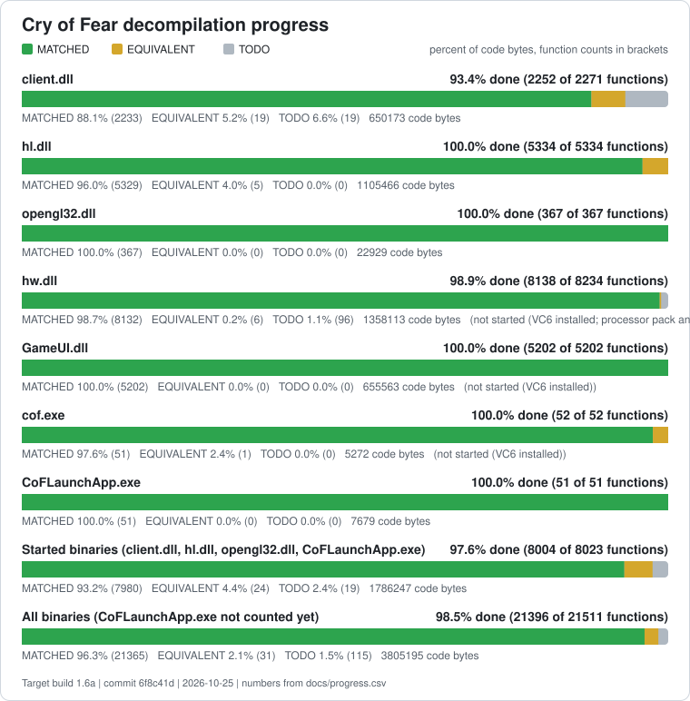

# Progress

Generated by `tools/progress.py` from `docs/progress.csv`. Do not edit by hand.

Target build 1.6a, commit f890e9f, 2026-10-24.

## client.dll

| Category | Matched | Equivalent | Total | Percent |
|---|---:|---:|---:|---:|
| HLSDK | 625 | 2 | 629 | 97.5% |
| PARANOIA | 260 | 0 | 261 | 93.2% |
| SPIRIT | 19 | 0 | 19 | 100.0% |
| COF | 354 | 15 | 371 | 98.8% |
| UNKNOWN | 926 | 6 | 971 | 83.4% |
| **All** | **2184** | **23** | **2251** | **93.1%** |

## hl.dll

| Category | Matched | Equivalent | Total | Percent |
|---|---:|---:|---:|---:|
| HLSDK | 2465 | 4 | 2469 | 100.0% |
| PARANOIA | 82 | 0 | 82 | 100.0% |
| SPIRIT | 409 | 0 | 409 | 100.0% |
| COF | 1781 | 7 | 1788 | 100.0% |
| UNKNOWN | 580 | 0 | 580 | 100.0% |
| **All** | **5317** | **11** | **5328** | **100.0%** |

## opengl32.dll

| Category | Matched | Equivalent | Total | Percent |
|---|---:|---:|---:|---:|
| HLSDK | 0 | 0 | 0 | 0.0% |
| PARANOIA | 367 | 0 | 367 | 100.0% |
| SPIRIT | 0 | 0 | 0 | 0.0% |
| COF | 0 | 0 | 0 | 0.0% |
| UNKNOWN | 0 | 0 | 0 | 0.0% |
| **All** | **367** | **0** | **367** | **100.0%** |

## CoFLaunchApp.exe

| Category | Matched | Equivalent | Total | Percent |
|---|---:|---:|---:|---:|
| HLSDK | 0 | 0 | 0 | 0.0% |
| PARANOIA | 0 | 0 | 0 | 0.0% |
| SPIRIT | 0 | 0 | 0 | 0.0% |
| COF | 49 | 2 | 51 | 100.0% |
| UNKNOWN | 0 | 0 | 0 | 0.0% |
| **All** | **49** | **2** | **51** | **100.0%** |

## Not started

- hw.dll: 8104 functions in the CSV, all TODO (not started (VC6 installed; processor pack and VS 2005 objects need those compilers)).
- GameUI.dll: 5251 functions in the CSV, all TODO (not started (VC6 installed)).
- cof.exe: 52 functions in the CSV, all TODO (not started (VC6 installed)).

## Counting rules

- **MATCHED**: the objdiff report gives 100 percent for the function: the instructions are identical to the retail binary. The report does not compare the names of relocation targets (many retail symbols are still unnamed); `tools/relocaudit.py` lists matched functions whose relocations point at differently named symbols.
- **EQUIVALENT**: the function compiles and its logic was verified against the assembly, but the code is not byte identical. The remaining difference is recorded in `docs/progress.csv`.
- **TODO**: every other function, including stubs and functions that do not compile.
- Rows of class LIB (static CRT, STL instantiations and compiler generated helpers from the toolchain) are not decompiled and are left out of every figure.
- Matched, Equivalent and Total in the tables are function counts. Percent is (MATCHED + EQUIVALENT) code bytes over all code bytes of the row; each function weighs its size in the retail binary.
- The SVG bars use the same byte weighting; the function counts are shown next to them.
